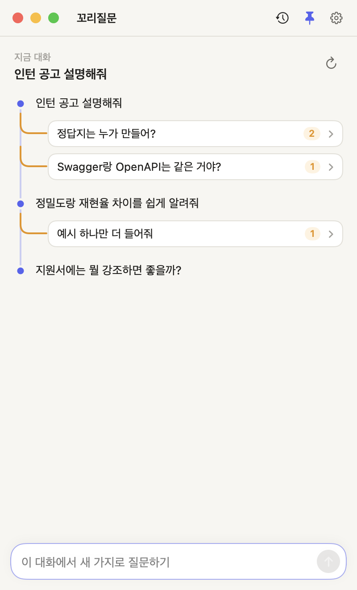
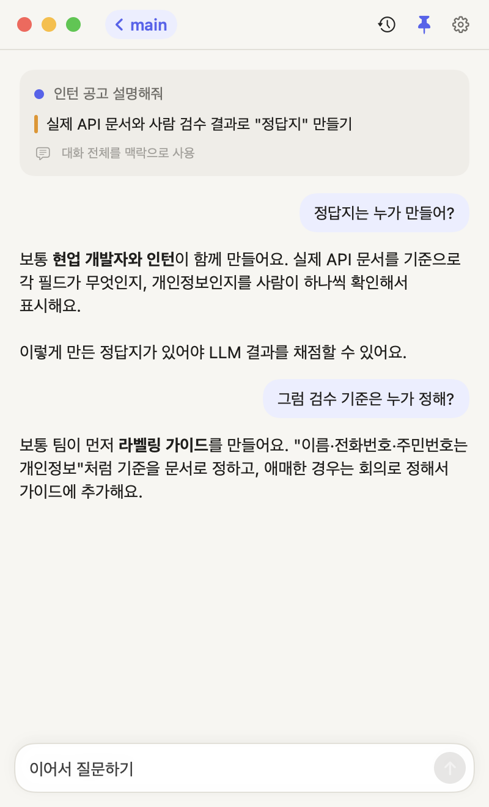
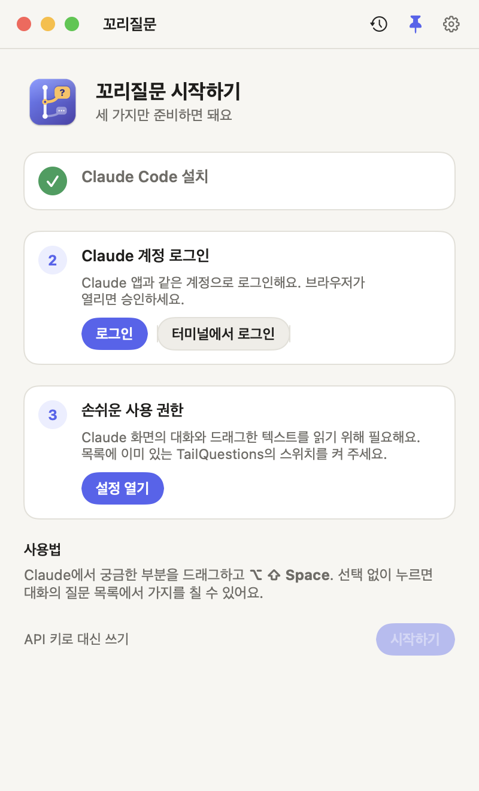
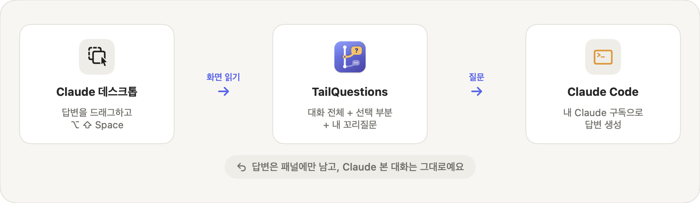

<div align="center">


# TailQuestions

**Claude 대화 옆에서, 곁가지 질문을 따로.**

Claude와 대화하다 생긴 꼬리질문을 본 대화에 섞지 않고<br>
같은 맥락을 아는 Claude에게 옆 패널에서 따로 물어보세요.


[**설치하기**](#설치) · [사용법](#사용법) · [작동 방식](#작동-방식)

<br>

&nbsp;&nbsp;


</div>

<br>

## 이런 앱이에요

git 브랜치처럼 생각하면 돼요. Claude와의 메인 대화가 **`main`**, 거기서 생긴 꼬리질문이 **가지**예요.

- 🌿 **질문마다 가지 치기** — main의 각 질문에서 여러 가지를 쳐서 따로 물어보고, main에서는 하던 대화를 계속해요.
- ✂️ **드래그해서 바로 질문** — Claude 답변에서 궁금한 부분을 드래그하고 `⌥ ⇧ Space`.
- 🧠 **맥락은 그대로** — 대화 전체를 함께 보내서, 같은 대화 안에서 물어본 것처럼 답해요.
- 🧹 **본 대화는 깨끗하게** — 꼬리질문과 답은 패널에만 남아요.
- 💳 **지금 쓰는 Claude 구독으로** — API 키나 추가 요금 없이, Claude Code 로그인으로 동작해요.
- 📌 **Claude 창에 붙어 다녀요** — Claude 창 옆에 붙어서 같이 움직이고, Claude가 보이는 데스크탑에서만 떠요.

<br>

## 설치

> **필요한 것:** macOS 14 이상 · [Claude 데스크톱 앱](https://claude.ai/download) · Claude 유료 구독(Pro/Max)

### 1. 앱 설치

터미널에 한 줄 붙여넣으면 끝이에요. 업데이트할 때도 같은 명령을 쓰면 돼요.

```bash
curl -fsSL https://raw.githubusercontent.com/lyemee/TailQuestions/main/install.sh | bash
```

<details>
<summary>직접 내려받아 설치하기</summary>

1. [Releases](https://github.com/lyemee/TailQuestions/releases/latest)에서 `TailQuestions.zip`을 내려받아 압축을 풀어요.
2. `TailQuestions.app`을 `응용 프로그램` 폴더로 옮겨요.
3. 처음 열 때 "확인되지 않은 개발자" 경고가 뜨면
   시스템 설정 → 개인정보 보호 및 보안 → 아래쪽의 **"그래도 열기"** 를 눌러요.

</details>

### 2. 설정 도우미 따라하기

앱을 처음 열면 설정 도우미가 떠요. 세 단계만 하면 돼요.



| 단계 | 하는 일 |
|---|---|
| **① Claude Code 설치** | 도우미에 있는 명령을 복사해 터미널에서 실행해요.<br>Claude 구독으로 답하기 위해 필요해요. |
| **② Claude 로그인** | `로그인` 버튼 → 브라우저에서 **Claude 앱과 같은 계정**으로 승인해요. |
| **③ 손쉬운 사용 권한** | `설정 열기` → 목록에서 **TailQuestions**를 켜요.<br>Claude 화면의 대화를 읽기 위해 필요해요. |

모두 체크되면 **시작하기**를 눌러요.

### 3. 계속 쓰려면

⚙️ 설정 → **"Mac에 로그인하면 자동으로 실행"** 을 켜 두면 Mac을 켤 때마다 메뉴바에 자동으로 떠 있어요.

<br clear="right">

## 사용법

| 하고 싶은 것 | 방법 |
|---|---|
| 답변 일부에 대해 꼬리질문 | Claude에서 텍스트를 **드래그 → `⌥ ⇧ Space`** |
| main 질문 목록과 가지 보기 | 선택 없이 **`⌥ ⇧ Space`** |
| 특정 질문에서 가지 치기 | 트리에서 질문에 마우스를 올리고 **`+ 가지`** |
| 그냥 바로 질문 | 트리 화면 아래 입력칸 (지금 대화 전체가 맥락으로 들어가요) |
| 꼬리의 꼬리질문 | 가지 화면 아래 입력칸에 이어서 입력 |
| 트리로 돌아가기 | 왼쪽 위 **`‹ main`** |
| 가지 삭제 | 가지를 **우클릭 → 가지 삭제** |
| 패널 닫기 / 열기 | 패널을 보는 중에 **`⌥ ⇧ Space`**, 또는 메뉴바 아이콘 |

입력칸에서 **Return** 은 보내기, **⌥ Return** 은 줄바꿈이에요.
헤더의 🕘 에서 다른 대화의 가지 기록을, 📌 으로 Claude 창에 붙어 다니기를 켜고 끌 수 있어요.

<br>

## 작동 방식

<p align="center"></p>

1. `⌥ ⇧ Space` 를 누르면 macOS **손쉬운 사용 API** 로 Claude 앱 화면의 대화와 선택한 텍스트를 읽어요.
2. 대화 전체(main)를 맥락으로, 선택한 부분과 질문을 함께 Claude에게 보내요.
3. 연결 방식은 두 가지예요 (⚙️ 설정에서 선택).
   - **Claude 구독 (기본값, 추천)** — 설치된 Claude Code(`claude -p`)로 질문해요. 로그인된 구독을 그대로 써서 추가 요금이 없어요.
     도구·설정·MCP 서버는 모두 끈 채로 실행되고, Claude Code 기록에도 남지 않아요.
   - **Anthropic API 키** — API를 직접 호출해요. 구독과 별도로 사용량만큼 요금이 나가요.

**데이터는 이 Mac에만 저장돼요.** 질문할 때 대화 내용이 Claude(Anthropic)로 전송되는 것 외에는 어디에도 보내지 않아요.

<details>
<summary>한계</summary>

- 화면에 보이는 텍스트만 맥락으로 넘어가요 (첨부 파일, 이미지, 프로젝트 자료, 메모리는 제외).
- 질문/답변 구분은 Claude 화면 구조에 의존해요. Claude 앱이 크게 바뀌면 구분이 안 될 수 있어요 (그래도 질문은 돼요).
- 구독 방식은 질문마다 Claude Code를 새로 실행해서 답이 시작되기까지 몇 초 걸려요.
- 가지에서 또 가지를 치는 중첩 가지는 아직 없어요.

</details>

<details>
<summary>문제 해결</summary>

| 증상 | 해결 |
|---|---|
| `⌥ ⇧ Space` 를 눌러도 반응이 없음 | 메뉴바에 아이콘이 있는지 확인 (없으면 `open ~/Applications/TailQuestions.app`) |
| "권한이 꺼져 있어요" 경고 | 손쉬운 사용 목록에서 TailQuestions를 **−** 로 지우고 다시 **+** 로 추가 |
| "로그인되어 있지 않아요" 오류 | ⚙️ 설정 → 설정 도우미 다시 보기 → 로그인 |
| "사용 한도에 도달" 오류 | 구독 사용량 한도예요. 잠시 후 다시 시도 |
| 트리에 대화가 안 보임 | 트리의 ↻ 버튼으로 다시 읽기. 계속 안 되면 `debug.log` 와 함께 이슈로 알려주세요 |

| 데이터 | 위치 |
|---|---|
| 가지 기록 | `~/Library/Application Support/TailQuestions/threads.json` |
| 진단 로그 (대화 내용 없이 길이·개수·화면 구조만) | `~/Library/Application Support/TailQuestions/debug.log` |

</details>

<details>
<summary>삭제</summary>

```bash
pkill -x TailQuestions
rm -rf ~/Applications/TailQuestions.app ~/Library/Application\ Support/TailQuestions
```

시스템 설정의 손쉬운 사용·로그인 항목 목록에서도 TailQuestions를 지워 주세요.

</details>

<br>

## 개발

<details>
<summary>소스에서 빌드하기</summary>

Xcode 없이 Command Line Tools(`xcode-select --install`)만 있으면 돼요.

```bash
git clone https://github.com/lyemee/TailQuestions.git
cd TailQuestions
./scripts/setup-signing.sh          # 로컬 서명 인증서 (한 번만 · 다시 빌드해도 권한 유지)
./scripts/build-app.sh --install    # 빌드 → ~/Applications 에 설치 → 실행
```

| 스크립트 | 하는 일 |
|---|---|
| `scripts/build-app.sh` | `.app` 빌드·서명 (`--install` 설치, `--universal` Apple Silicon + Intel) |
| `scripts/package-release.sh` | 배포용 `build/TailQuestions.zip` 생성 |
| `scripts/make-icon.swift` | 앱 아이콘 생성 |
| `TailQuestions --snapshot docs` | README 스크린샷을 실제 화면 코드로 생성 |

</details>

<details>
<summary>코드 구조</summary>

| 파일 | 역할 |
|---|---|
| `AppDelegate.swift` | 메뉴바 아이콘, 전역 단축키, 단축키를 눌렀을 때의 흐름 |
| `AXReader.swift` | Claude 앱 화면에서 선택한 텍스트, 대화 내용, 창 위치·순서 읽기 |
| `PanelController.swift` | Claude 창 옆에 붙어 같은 높이·데스크탑으로 움직이는 패널 |
| `ClaudeCodeClient.swift` | Claude Code CLI로 구독을 써서 질문, 로그인 상태 확인 |
| `ClaudeClient.swift` | Anthropic Messages API 스트리밍 호출 (API 키 방식) |
| `AppModel.swift` | 가지 상태, main-가지 트리, 설정 도우미, 저장, 프롬프트 |
| `Views.swift` / `Theme.swift` | SwiftUI 화면 / 색상·공통 컴포넌트 |
| `Snapshot.swift` | README 스크린샷 생성 |

</details>
